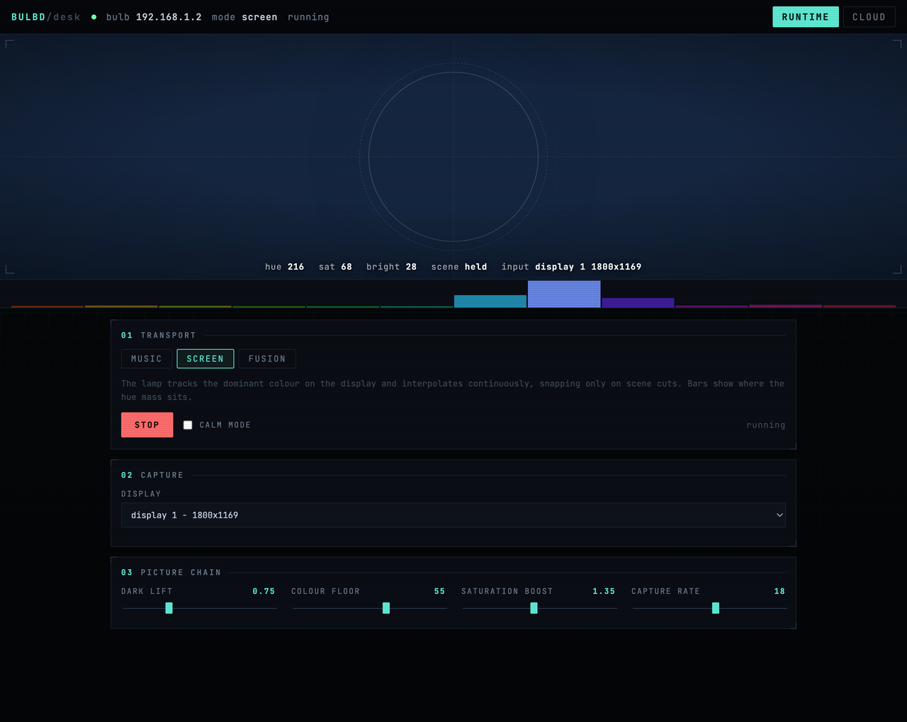
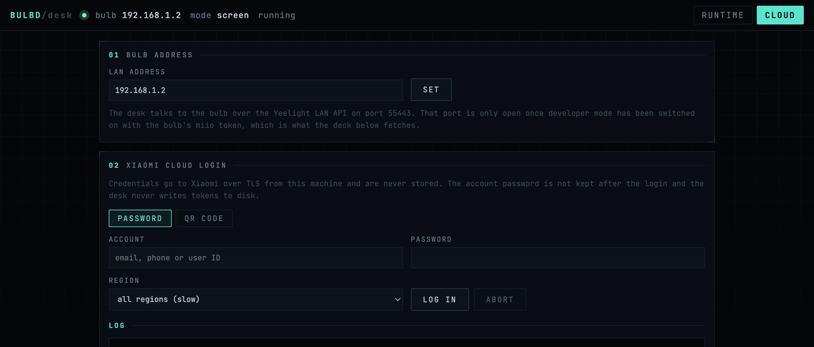

<div align="center">


# bulbd

**Make a Xiaomi bulb dance to your music, your films, or both at once.**

DSP in, hue out — plus a built-in Xiaomi cloud token extractor.

`music` · `screen` · `fusion` · local web desk · miio token extraction

<br>



<sub>Screen mode, mid-run. The address in the top bar is this machine's — yours will differ.</sub>

</div>

---

## What this is

A Mi Smart LED Bulb Essential (White & Color, `yeelink.light.color5`) driven
over the Yeelight LAN API at 25 updates a second. Three ways to drive it:

| Mode | Source | Behaviour |
|---|---|---|
| **music** | microphone or loopback PCM | onset detection steps the colour through palette anchors |
| **screen** | whatever is on a display | dominant on-screen colour, interpolated, snapping on scene cuts |
| **fusion** | both | the display picks hue and saturation, the audio drives brightness |

Music mode never drifts the hue freely — colour moves in discrete palette
steps on onsets. Screen mode deliberately does the opposite, because an
ambient lamp tracking a film should follow the picture rather than march
through a palette.

The bulb isn't supported by the Yeelight app. Developer mode was switched on
through python-miio, which opens port 55443; `start_music` then bypasses the
~60 commands/minute quota. Getting that far needs the bulb's miio token,
which lives in the Xiaomi cloud — see [Getting the token](#getting-the-token).

## Install

```bash
pip install -e .            # the light engine
pip install -e ".[cloud]"   # plus the Xiaomi cloud / token half
```

The base install is `yeelight numpy soundcard python-miio mss`; the `cloud`
extra adds `requests`, `pycryptodome`, `charset-normalizer`, `Pillow` and
`colorama` (`requirements.txt` lists the same five). If you already have a
token, you can skip it — the dashboard imports the extractor inside a
`try`/`except` and simply turns off the Xiaomi login in Setup when it isn't there.

`python music_bulb.py` and `python music_bulb_dash.py` run straight from the
checkout; the install also gives you them as `bulbd` and `bulbd-desk`.

macOS only, as written.

## Find the bulb first

Every command below wants `--ip`, and that address is whatever your own
router handed the bulb — there is no default, and nothing in this repo is
hard-coded to a particular network. Three ways to find it, best first:

1. **The desk's Setup page.** The device table has an **Address** column: the cloud
   already knows every device's LAN address, so the same login that fetches
   your token hands you the address to point `--ip` at. It is the only route
   that works *before* developer mode is on, and you have to do that login
   anyway — so in practice you never hunt for the address separately. See
   [Getting the token](#getting-the-token).
2. **The miio hello**, which every Xiaomi device answers on UDP 54321 with
   its device id (SSDP discovery returns nothing on some Macs, this one
   included):
   ```bash
   python tools/check_link.py "$BULB_IP" hello    # is it there, and which id
   python tools/check_link.py "$BULB_IP" find     # where that id is now
   ```
3. **Your router's DHCP lease table**, or `arp -a`, and match the MAC the
   cloud reported.

A DHCP reservation is still worth making. Without one the desk copes: it
remembers the bulb's device id the first time it connects, and when the
address stops answering with that id it broadcasts the hello on your LAN
(then asks every address of the /24 if the router drops broadcasts), moves to
wherever the bulb answers and saves the new address.

The rest of this README writes that address as `BULB_IP`.

## Quick start

```bash
BULB_IP=192.0.2.10          # yours, not this one
```
```bash
python music_bulb_dash.py --ip "$BULB_IP"
```

Open the URL it prints. Everything is live: mode, palette, sensitivity,
capture rate, the lot. The desk can also take the address from its Setup
page, in which case you can start it with no `--ip` at all, and it remembers
the address and every control for the next start. Or drive it headless:

```bash
python music_bulb.py --ip "$BULB_IP"                    # music
python music_bulb.py --ip "$BULB_IP" --screen           # screen
python music_bulb.py --ip "$BULB_IP" --fusion           # both
python music_bulb.py --ip "$BULB_IP" --fade 1.5         # sweep, don't snap
python music_bulb.py --ip "$BULB_IP" --lead 0           # flash when heard
```

`--fade SECONDS` keeps the palette anchors and the onsets that pick them;
only the traversal between two anchors becomes a timed sweep on a smoothstep
ramp. Steps are spaced at least `fade` apart so one sweep lands before the
next begins.

`--lead MS` (default 80) is **Beat sync**. A flash sent when the beat is
heard lands late: the onset shows at the end of its 23 ms block, then comes
the Wi-Fi hop and the bulb's 50 ms ramp. Once four beats in a row sit on the
tempo, the next beat is predicted and its flash sent that many ms early. A
beat gives one flash: the real onset arriving for a beat already flashed is
claimed, not flashed again. When the music stops or holds a note, at most
the one beat already due is flashed before it falls back to flashing what it
hears. Colour still steps only on accents that were really heard; an accent
on a predicted beat makes its step land with the next predicted flash. 80 ms
is about half the measured round trip plus half the ramp, aimed slightly
early because a light that leads the sound is noticed only past ~125 ms and
one that trails it past ~45 ms; it was confirmed on the lamp here. Raise it if
flashes still trail the beat on your network, lower it if your speakers lag.

## The desk

The left half is the colour going to the bulb right now, with the last 30
seconds of colour under it and a strip of 10 audio bands — or 12 hue bins in
screen mode, each bar painted with the hue it counts. The controls sit in one
column on the right; under 1000 px the colour folds into a band at the top.

The desk swaps its controls to match the mode. Fusion shows both halves minus
what it can't use: the palettes, the colour fade and the dark lift have
nothing to act on when the display owns the hue and the audio owns the
brightness.

- **Auto** (beside Calm) picks the mode from what is happening: sound and a
  moving picture → Fusion, sound only → Music, a moving picture only →
  Screen, neither → Screen (a still picture is read twice a second and the
  lamp holds its colour, so a paused film keeps its light). The mode picker
  shows the mode it picked; picking one by hand turns Auto off. It holds
  through ordinary gaps: sound counts after 2 s and is let go after 10 s of
  silence, a picture counts as moving after two looks in a row and as still
  after 15 s, and a pick stays at least 10 s. Watching the input the current
  mode does not use is cheap: in Music one screen grab every 2 s (every 4 s
  after a still minute), in Screen the input's level only. Without Screen
  Recording permission Auto stays on Music.
- **Presets** sit under Start: one click sets mode, Auto, palette, Calm and
  every fader. Club, Lounge, Cinema and Concert are built in; **Save as
  preset** keeps the current look under a name, **Edit** renames or deletes
  your own. A preset never touches the address, input, display, area or Beat
  sync, which describe your room rather than a look. The chip of the preset
  the desk matches is pressed; move a fader and none is.
- **Beat sync** is the fader for `--lead` (music and fusion), Off at 0.

- **Input** (music and fusion) lists every capture device plus *Automatic*,
  which names the device it resolves to. The bar under it is the raw input
  level in dBFS; after 1.5 s under -70 dBFS it reads **No signal** and so does
  the top bar, because a silent input otherwise looks exactly like a broken
  lamp. A saved input that is unplugged shows as *not connected* and Start
  says so instead of touching the bulb.
- **Area** (screen and fusion) shows a still of the chosen display; drag a box
  on it to capture only that part — a player window without its controls, the
  picture without the menu bar or the dock. Drag the box or its corners to
  adjust, arrow keys nudge it (Shift resizes), **Whole display** clears it. The
  still is taken when the area comes into view, on a display change and when
  you come back to the page, never on a timer, and only a desk bound to
  localhost serves it; elsewhere you draw on a blank outline.
- Changing mode, input, display or area swaps the capture on the same bulb
  connection. **Stop** puts the lamp back the way it was before Start —
  power, brightness, and colour or white temperature — and so does Ctrl-C;
  `--no-restore` leaves it on the last colour sent. The CLI does the same.
- Settings — address, the bulb's device id, input, mode, Auto, palette,
  Calm, every fader, display, area and your presets — are saved to `~/Library/Application Support/bulbd/settings.json`
  a second after the last change and loaded at start (`--settings PATH` to
  move it, `--settings ''` to keep nothing). Start/Stop is not saved: the lamp
  never turns on by itself. `--ip` and `--mic` win over the file, and a
  broken file costs only the values it breaks.

Binds to localhost. `--host 0.0.0.0` reaches it from your phone — there is no
authentication, so only on a network you trust.

## Getting the token

The bulb's miio token is the one thing you can't read off the device. It
normally means a second checkout of
[Xiaomi-cloud-tokens-extractor](https://github.com/PiotrMachowski/Xiaomi-cloud-tokens-extractor).
That extractor is vendored here and wired into the desk instead, so the whole
setup is one repo:

1. Open **Setup**: click the bulb address in the top bar, or **Set up bulb**
   when none is set yet.
2. Log in with your Xiaomi account password, or scan a QR code in the Mi Home
   app. Captchas and 2FA codes are answered in the page.
3. The device table lists everything on the account: name, model, **Address**,
   token. Both halves of what you need are on that one row — the token to
   unlock the LAN API, and the address to talk to it on afterwards.
4. **Use** points the desk at that address, so you never have to type it.
   **Enable LAN** sends the token to the bulb, turns developer mode on and
   opens port 55443.



That's the entire provisioning path, and it is also the easiest way to answer
"what is my bulb's IP?" — the cloud knows, and the table shows it. Afterwards
the desk never needs the cloud again; no token is stored anywhere in this
project.

Note the address the table reports is a DHCP lease, not a fixed property of
the bulb. If the light stops responding weeks later, check that row again
before assuming the bulb is dead.

The extractor still works as its original CLI:

```bash
python token_extractor.py
python token_extractor.py -ni -u you@example.com -p secret -s de -o out.json
```

### Handling of credentials

- Cloud endpoints are refused unless the server is bound to loopback, or you
  started it with `--allow-remote-login`. Your Xiaomi password crosses that
  socket and the desk has no authentication.
- The password is not kept after the login, and nothing from the login is
  written to disk. The desk's settings file holds only the controls listed
  under [The desk](#the-desk).
- Tokens are masked in the log pane; the device table reveals one row at a
  time, on request. They're account secrets — treat them like a password.

## Audio capture on macOS

`soundcard` has no CoreAudio loopback: `include_loopback=True` warns and is
ignored. BlackHole is a virtual cable, not a system tap — it only carries
what macOS *outputs* into it, so capturing from it while your output is the
built-in speakers gives you digital silence, which looks exactly like a
broken install.

To feed it, build a **Multi-Output Device** in Audio MIDI Setup containing the
physical output *and* BlackHole 2ch — physical device first as master, drift
correction ticked on BlackHole only, both members at the same sample rate —
then select it as the system output:

```bash
python music_bulb.py --ip "$BULB_IP" --mic "BlackHole 2ch"
python music_bulb.py --list-devices
```

With a Multi-Output device (or BlackHole itself) selected as the system
output, `--mic` is optional: the virtual cable is picked automatically, in the
CLI and on the desk. With a plain output selected it falls back to the
microphone. On the desk the **Input** picker does what `--mic` does, and its
level bar shows the silence straight away.

Multi-Output devices ignore the hardware volume keys: set the level in the
playing app, and leave BlackHole's own gain at full or the capture goes quiet.

## Screen capture on macOS

Uses `mss`, about 20-26 ms for a grab of any size, so ~33 fps is the practical
ceiling. Most of that cost lands in macOS itself (WindowServer and the
permission daemons), not in this process, so the capture rate is the battery
dial: it defaults to 10 fps and drops to 5 and then 2 while the picture holds
still, returning to full on the first frame that changes. Without Screen Recording permission macOS hands back the desktop
wallpaper instead of an error, so the code preflights the permission and
refuses to start rather than quietly lighting your room the colour of your
wallpaper.

```bash
python music_bulb.py --list-monitors     # index 0 is the union of all displays
python music_bulb.py --ip "$BULB_IP" --screen --screen-region 0,40,1800,1000
```

`--screen-region X,Y,W,H` is in desktop points; on the desk, draw the
**Area** instead.

## When the bulb stops answering

The desk says why in plain words, with **Open Setup** where the fix is there:
nothing answers at the address (and, if it knows the bulb's id, not anywhere
else on the LAN either); the address is another device; the bulb is there but
LAN control is off (**Enable LAN** in Setup); the bulb is there but takes no
more connections (wait, then power-cycle); or it could not connect back to
this computer, which music mode needs (a firewall). It finds out with one
miio hello and the connect and `get_prop` that starting does anyway.

If the link drops mid-session it reconnects on its own - 6 tries over about a
minute, 1, 2, 4, 8, 15 and 30 s apart, through the same open and release as
Start - and stops trying the moment you press Stop. The top bar counts the
tries. A power cycle at the wall was back in about 9 s here.

**"Bulb closed the connection."** The bulb accepts only a handful of LAN
connections at once, and every dropped session used to burn a slot until it
timed out — a few failed starts could lock it out completely. `open_bulb()`
and `release_bulb()` now own that lifecycle: retry with backoff, force-close
the socket on every exit path. Nothing should construct `yeelight.Bulb`
directly.

If it's already wedged, that fix can't reach it — power-cycle at the switch.
To tell a wedged bulb from a dead one, ask the channel that doesn't use the
control socket:

```bash
python tools/check_link.py "$BULB_IP" hello
```

SSDP keeps advertising power/bright/hue/sat, and a raw miio hello on UDP
54321 keeps answering, even while port 55443 accepts TCP and then hangs up.
Both alive plus 55443 refusing means burnt connection slots — not a network
or firmware problem.

And ping the bulb before blaming the code. Round trips here run 23–106 ms over
Wi-Fi, which is high for a LAN; Beat sync hides the average, not the jitter.

## Limits worth knowing

- Don't exceed ~30 updates/sec. The LEDs can't resolve past it, so the loops
  clamp the rate and drop frames inside the perceptual deadband of the last
  one sent. A predicted beat may go out between two regular sends, but never
  within 33 ms of the last one.
- Grey scenes in Screen and Fusion go to the bulb's white LEDs: a colour
  temperature from the picture's neutral light (6500 K for a white page,
  warmer for warm greys, 2700 K at the floor), sent at 0.4 of the colour
  frame's brightness number, because the white LEDs are that much brighter.
  The gap between going white and coming back keeps a scene on the line from
  flapping, and the switch crossfades over 300 ms. The match was set on the
  lamp with `tools/check_white.py`.
- In fusion mode the audio loop must call `record()` every ~23 ms or the input
  buffer backs up and onsets arrive late. A full-display grab costs ~26 ms, so
  capture runs on its own thread and publishes the latest colour; its scene-cut
  flag is sticky until read, so a cut can't fall into the gap between sends.

## Tests

```bash
pip install -e ".[test]"
python -m pytest
```

Offline and deterministic: no bulb, no screen-recording permission, no audio
device, no network (a test that opens a socket fails). It feeds synthetic
drums, tones, noise and solid frames through the analyser, colour engines,
capture pacer and sender, and checks the yeelight wire format against a fake
socket; the connection recovery, Beat sync, white frames, Auto and presets
run against fakes of the bulb, the LAN and the clock. About 35 seconds.

## Layout

```
music_bulb.py        DSP, screen capture, CLI, bulb lifecycle
music_bulb_dash.py   the web desk; CloudSession drives the login
token_extractor.py   Xiaomi cloud token extractor, importable and still a CLI
tests/               pytest suite (synthetic signals in tests/signals.py)
tools/check_bulb.py  manual check against a real bulb; not part of the suite
tools/check_link.py  hello, find, diagnose and a power-cycle reconnect, real bulb
tools/check_white.py white-LED brightness match and temperature sweep, real bulb
tools/check_sync.py  Beat sync against a click track on your speakers, real bulb
tools/fake_bulb.py   a stand-in bulb on localhost for trying the desk without one
```

## Credits

The token extractor is
[Piotr Machowski's](https://github.com/PiotrMachowski/Xiaomi-cloud-tokens-extractor),
vendored here and refactored to be importable — `argparse` moved into
`main()`, and every `input()`/`print()` in the login flow put behind a
`Prompter` seam so the terminal and the browser can drive the same code. See
the upstream project for its licence and for the flows this doesn't exercise.

Bulb control via [yeelight](https://gitlab.com/stavros/python-yeelight) and
[python-miio](https://github.com/rytilahti/python-miio).
